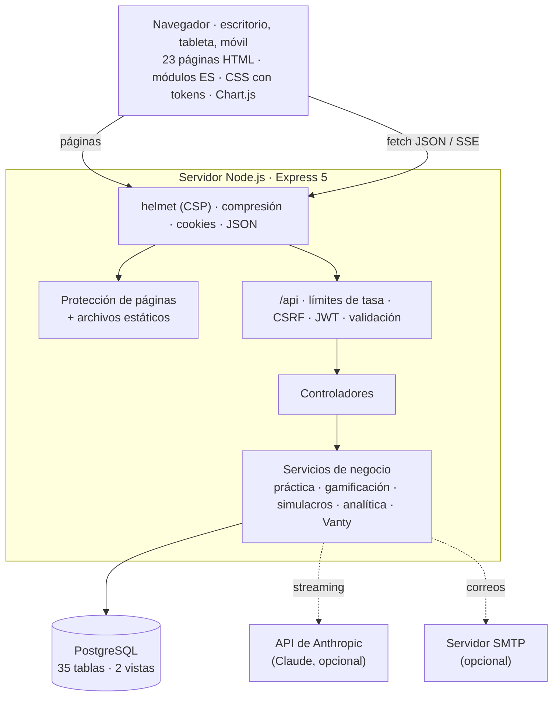
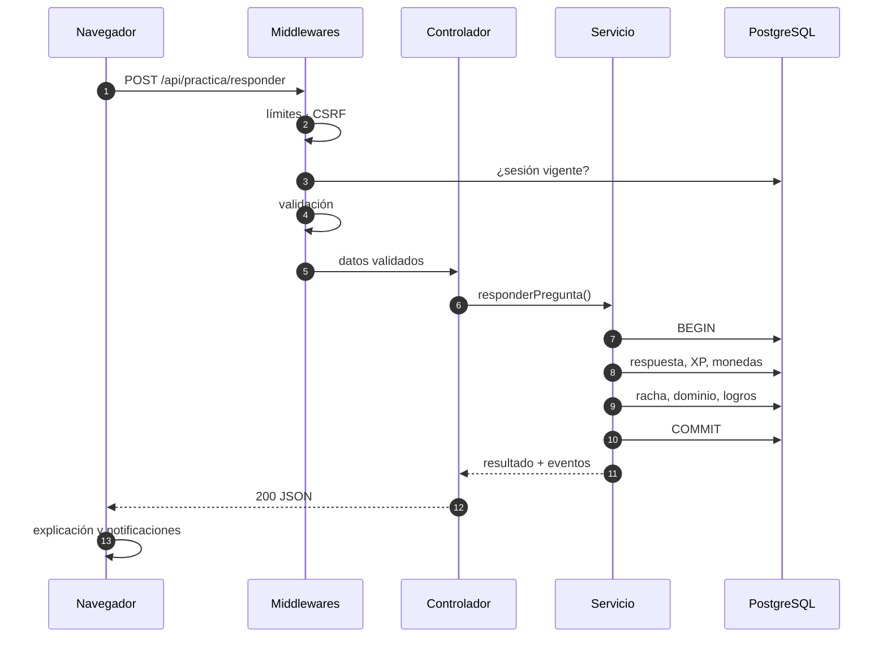

# Arquitectura de ICFES Lab

ICFES Lab es una aplicación web **monolítica en capas**: un único servidor Node.js + Express entrega el frontend (HTML, CSS y JavaScript sin frameworks) y expone una API REST en `/api`, respaldada por PostgreSQL. La IA de Vanty usa la API de Anthropic (Claude) cuando hay una clave configurada y, si no, un motor local.

## Visión general



| Capa | Tecnología | Responsabilidad |
|---|---|---|
| Presentación | HTML5, CSS3, JavaScript (módulos ES), Chart.js | Interfaz responsive, gráficas, componentes reutilizables, estado de cada página. |
| HTTP | Express 5, helmet, compression, cookie-parser, express-rate-limit | Seguridad de cabeceras, límites de tasa, CSRF, enrutamiento, archivos estáticos. |
| Aplicación | Controladores + express-validator | Validar la entrada, llamar al servicio y responder en JSON (o SSE para Vanty). |
| Dominio | Servicios (`backend/src/services`) | Reglas de negocio: práctica adaptativa, XP, rachas, logros, simulacros, puntajes, analítica, Vanty. |
| Datos | PostgreSQL + `pg` (SQL parametrizado) | Persistencia, integridad referencial, transacciones, vistas analíticas. |
| Integraciones | SDK `@anthropic-ai/sdk`, `nodemailer` | IA de Vanty y correo de recuperación. Ambas son opcionales. |

---

## Backend

```
backend/src/
├── server.js                  Arranque: verifica la BD, escucha el puerto, cierre ordenado (SIGINT/SIGTERM)
├── app.js                     Express: helmet/CSP, compresión (sin SSE), JSON, /api, páginas, estáticos, errores
├── config/
│   ├── env.js                 Carga y valida el .env (único lugar que lee process.env)
│   ├── db.js                  Pool de PostgreSQL, parsers de tipos, helpers una/varias/transaccion
│   └── reglas.js              Balance del juego: XP, monedas, umbrales de dominio, topes, estrellas, puntajes
├── middlewares/
│   ├── auth.js                JWT (firma, cookie httpOnly, requireAuth, requireRol)
│   ├── csrf.js                Cabecera X-Requested-With obligatoria en métodos que modifican datos
│   ├── limites.js             Límites de tasa (API, login, registro, recuperación, Vanty)
│   ├── validar.js             Errores de express-validator → 422 uniforme
│   ├── paginas.js             Protección de las páginas HTML privadas y de administración
│   └── errores.js             Manejador central de errores (JSON en español, 404 HTML)
├── routes/                    Definición de rutas + validadores de cada endpoint
├── controllers/               Traducen HTTP ↔ servicios (leen solo datos validados)
├── validators/comunes.js      Validadores reutilizables (email, contraseña, ids, slugs, fechas…)
├── services/                  Lógica de negocio (ver tabla)
│   └── vanty/                 IA tutora: contexto, intención, recomendaciones, Claude, motor local
├── utils/                     AppError, fechas en la zona horaria de la app, azar con semilla, texto
└── scripts/                   db-setup, db-seed, db-demo, generar-sql, crear-admin, generar-iconos
```

### Servicios de dominio

| Servicio | Qué hace |
|---|---|
| `auth.service` | Registro, inicio de sesión, sesión actual, cierre de todas las sesiones, recuperación y restablecimiento de contraseña. |
| `perfil.service` | Perfil, avatar (solo artículos adquiridos), insignia destacada, configuración, cambio de correo y contraseña, eliminación de cuenta. |
| `catalogo.service` | Materias → temas → subtemas con el avance del estudiante y la siguiente lección sugerida. |
| `lecciones.service` | Contenido de lecciones (con bloqueo por nivel), finalización con recompensas y "lección del día". |
| `practica.service` | Práctica adaptativa: dificultad objetivo, prioridad de preguntas (repaso espaciado) y registro de respuestas. |
| `progreso.service` | Estadísticas diarias por materia y dominio por subtema (promedio móvil exponencial). |
| `gamificacion.service` | Otorga XP y monedas, procesa subidas de nivel, entrega insignias, descuenta compras. |
| `racha.service` | Actividad diaria, racha con protectores, hitos de racha y calendario de actividad. |
| `logros.service` | Métricas del estudiante y desbloqueo de logros. |
| `simulacros.service` | Catálogo, selección de preguntas, intentos por sesiones, cronómetro del servidor, calificación y resultados. |
| `puntaje.service` | Puntaje por área, puntaje global 0–500, estimación bayesiana y proyección al examen. |
| `analitica.service` | Datos del dashboard y del análisis completo ("Avance"). |
| `tienda.service` | Catálogo de la tienda y compras (artículos, insignias, protectores). |
| `contenido.service` | Validación e importación de preguntas y lecciones (JSON y panel de administración). |
| `admin.service` | Métricas, banco de preguntas, usuarios y configuración global. |
| `config.service` | Configuración global con caché de 30 s y fecha del ICFES (global o personal). |
| `vanty/*` | Ver [VANTY.md](VANTY.md). |

### Ciclo de una petición

Ejemplo: el estudiante responde una pregunta de práctica.



Principios que se repiten en toda la API:

- **Transacciones completas.** Cada acción que otorga recompensas (responder, completar lección, calificar simulacro, comprar) corre en una sola transacción: o se registra todo o no se registra nada.
- **Eventos de gamificación.** Los servicios devuelven una lista `eventos` (`xp`, `monedas`, `nivel`, `racha`, `protector_usado`, `recompensa_racha`, `logro`, `subtema_completado`…) que el frontend convierte en notificaciones, y un resumen `jugador` para refrescar la cabecera sin otra petición.
- **Errores tipados.** Los servicios lanzan `AppError(status, mensaje, { codigo })`. El manejador central responde `{ error, codigo, detalles? }`.
- **Configuración centralizada.** El balance del juego vive en `config/reglas.js` y la configuración de entorno en `config/env.js`.

---

## Frontend

Es una **aplicación multipágina (MPA)** sin paso de compilación: cada página HTML carga un único módulo de `js/paginas/` y reutiliza los módulos de `js/core/`.

| Módulo (`js/core`) | Función |
|---|---|
| `layout.js` | Estructura común (cabecera con XP, monedas y racha; barra lateral; navegación inferior en móvil; menú de usuario). Carga la sesión (`/api/auth/me`) y procesa las recompensas. |
| `api.js` | Cliente HTTP: `api.get/post/put/patch/del`, cabecera anti-CSRF, errores tipados (`ErrorApi`), redirección al login ante un 401 y lectura de streams SSE (`flujo`). |
| `dom.js` | Constructor de DOM seguro `h()` (sin `innerHTML`), iconos del sprite y formatos en español de Colombia (números, porcentajes, fechas, duraciones). |
| `pregunta.js` | Componente de pregunta tipo ICFES en tres modos: práctica, examen (simulacros) y revisión. Lo usan la práctica, las lecciones, los simulacros, los resultados y Vanty. |
| `texto-rico.js` | Markdown ligero y seguro (negritas, cursivas, código, listas, tablas y solo enlaces internos) para las respuestas de Vanty y las lecciones. |
| `graficas.js` | Envoltorio de Chart.js con los colores de la marca y soporte de modo oscuro. |
| `avatar.js` | Avatar SVG compuesto por color, expresión, accesorio y fondo. |
| `ui.js` | Toasts, modales, confirmaciones, confeti, estados de carga, vacío y error, pestañas. |
| `tema.js` | Tema claro, oscuro o del sistema. |

**Estilos.** `tokens.css` define la paleta (`#d5e068` verde lima, `#484ea2` azul oscuro, `#81a1f6` azul claro, `#fda879` naranja de la racha), la tipografía, los espacios y las sombras, con variantes para modo oscuro. Sobre ellos se construyen `base.css`, `componentes.css`, `layout.css`, `pregunta.css` y una hoja por página en `css/paginas/`.

**Diseño responsive.**

| Ancho | Diseño |
|---|---|
| ≥ 1200 px | Escritorio: barra lateral con textos, rejillas de 3–4 columnas. |
| 768–1199 px | Tableta: barra lateral compacta (solo iconos), rejillas de 2 columnas. |
| < 768 px | Móvil: navegación inferior fija, una columna, chat de Vanty a pantalla completa. |

Las páginas `inicio.html` y `simulacros-completos.html`/`minisimulacros.html` conservan los identificadores, las clases y la estructura visual de los prototipos originales (`dias-racha`, `mensaje-estudio`, `dias-icfes`, `graficobarras`, `graficoRadar`, tarjetas de simulacro y camino de minisimulacros).

---

## Seguridad

| Riesgo | Medida |
|---|---|
| Robo de contraseñas | `bcrypt` con costo 12. Política: 8–72 caracteres con al menos una letra y un número. El login compara contra un hash de referencia cuando el correo no existe, para no revelar qué cuentas están registradas. |
| Sesiones | JWT HS256 con emisor y expiración (7 días), firmado con `JWT_SECRET` (obligatorio en producción, ≥ 32 caracteres). Viaja en una cookie `httpOnly` y `SameSite=Lax` —además `Secure` cuando la aplicación se publica por HTTPS—, o en `Authorization: Bearer`. En cada petición se verifica en la BD que la cuenta siga activa y que `token_version` coincida: cambiar o restablecer la contraseña y "cerrar todas las sesiones" invalidan los tokens emitidos. |
| Transporte | Si `APP_URL` usa `https://` se envían HSTS (1 año) y `upgrade-insecure-requests`, y la cookie es `Secure`; detrás de un proxy (`TRUST_PROXY=true`) toda petición que llegue por HTTPS recibe la cookie `Secure`. Por HTTP (desarrollo o una red local sin certificado) esas protecciones se omiten para que la aplicación funcione desde cualquier dispositivo. |
| CSRF | `SameSite=Lax` + cabecera `X-Requested-With: XMLHttpRequest` obligatoria en POST/PUT/PATCH/DELETE (un sitio externo no puede enviarla sin CORS, que el servidor no habilita). |
| Acceso no autorizado | `requireAuth` y `requireRol('admin')` en la API. Todas las consultas filtran por `usuario_id` (intentos, conversaciones, resultados). Las preguntas generadas por Vanty son privadas de su autor (restricción `CHECK` en la BD). |
| Páginas privadas | El servidor redirige a `/login?next=…` antes de entregar el HTML de cualquier página privada y a `/inicio` si alguien sin rol de administrador abre `/admin`. El HTML se sirve con `Cache-Control: no-store`. |
| Inyección SQL | Todas las consultas usan parámetros (`$1`, `$2`…). La única interpolación es la zona horaria, validada con una expresión regular al arrancar. Los nombres de columnas dinámicos provienen de listas blancas del código, nunca del cliente. |
| XSS | CSP estricta (`script-src 'self'`, sin scripts en línea, `object-src 'none'`, `frame-ancestors 'none'`). El frontend construye el DOM con `createElement`/`textContent`. El markdown de Vanty pasa por un intérprete propio que no admite HTML ni enlaces externos. Los correos escapan los datos del usuario. |
| Validación de datos | `express-validator` en todas las rutas; los controladores solo leen los campos declarados (`matchedData`), lo que evita la asignación masiva. La BD refuerza la integridad con `CHECK`, llaves foráneas y un trigger diferido (cada pregunta con 4 opciones y 1 correcta). |
| Fuerza bruta y abuso | API: 1500 peticiones cada 15 min por IP. Login: 10 intentos fallidos cada 15 min. Registro: 10 por hora. Recuperación: 6 por hora. Vanty: 12 mensajes por minuto por usuario y un límite diario configurable (80 por defecto). |
| Recuperación de contraseña | Token aleatorio de 256 bits del que solo se guarda el SHA-256. Vence en 1 hora, es de un solo uso e invalida los anteriores. La respuesta es idéntica exista o no el correo. Al restablecer se cierran todas las sesiones. |
| Manipulación del cronómetro | El tiempo de los simulacros lo controla el servidor (`iniciada_en` + `duracion_seg`), con 10 s de gracia para la latencia de red. Las sesiones vencidas se cierran solas. |
| Abuso de recompensas | Repetir una pregunta acertada en las últimas 24 h da 1 XP. Repetir un simulacro da el 25 % de sus recompensas. Cada movimiento queda en `historial_recompensas`. |
| Inyección de instrucciones en la IA | El perfil del estudiante y las preguntas adjuntas se envían a Claude marcados como datos, y el prompt del sistema indica no seguir órdenes que aparezcan en ellos. La salida del generador de preguntas se valida estructuralmente antes de guardarla. |
| Fugas de información | El manejador de errores responde mensajes en español sin detalles internos en producción; las trazas solo aparecen en desarrollo. `x-powered-by` está desactivado. Cuerpos JSON limitados a 200 kB (3 MB en la importación de preguntas). |
| Cuenta | Cambiar el correo o eliminar la cuenta exige la contraseña actual. La eliminación borra en cascada todos los datos del estudiante. |

---

## Decisiones de diseño

| Decisión | Motivo |
|---|---|
| **MPA con JavaScript sin frameworks** | Cumple el stack pedido (HTML5, CSS3, JS), no necesita compilación y cada página carga solo lo que usa. Los componentes comunes viven en `js/core`. |
| **Express 5** | Propaga automáticamente los errores de los manejadores `async` al manejador central. |
| **SQL directo con `pg` (sin ORM)** | La analítica usa consultas con agregados, `FILTER`, `LATERAL` y ventanas que un ORM complicaría. Las transacciones son explícitas. |
| **`CHECK` en lugar de `ENUM`** | Es más sencillo agregar valores (por ejemplo, un nuevo origen de respuesta) sin migraciones de tipos. |
| **`materia_id` y `subtema_id` desnormalizados en `respuestas`** | Evitan tres `JOIN` en cada consulta analítica. |
| **Agregados diarios (`actividad_diaria`, `estadisticas`)** | Las gráficas del dashboard (horas por semana, evolución, calendario) leen pocas filas por usuario. |
| **Cronómetro en el servidor** | El puntaje de un simulacro no depende del reloj del navegador y el intento se puede reanudar en otro dispositivo. |
| **Simulacros completos con semilla fija** | "Simulacro 3" tiene las mismas preguntas para todos, así los resultados son comparables. Los minisimulacros son adaptativos. |
| **Vanty híbrido (Claude + motor local)** | La plataforma funciona sin clave de API y sin costo, y si la API falla el estudiante recibe una respuesta local en lugar de un error. |
| **Zona horaria de la aplicación** | Las rachas y los días de estudio se calculan en `America/Bogota` (configurable), no en UTC, para que la medianoche coincida con la del estudiante. |
| **Reglas en `config/reglas.js`** | El balance del juego (XP, umbrales, topes) se ajusta sin tocar la lógica. |
| **Contenido en JSON versionable** | Las preguntas y lecciones viven en `database/contenido/` con un formato documentado, se validan antes de importarse y se pueden revisar en control de versiones. |

## Pruebas

| Comando | Cobertura |
|---|---|
| `npm test` | 32 pruebas unitarias de lógica pura (sin base de datos): puntaje por área y global, estrellas, regresión lineal, dominio (EMA), dificultad objetivo, prioridad de preguntas, detección de intención de Vanty, recomendaciones de Vanty, validación de preguntas generadas por la IA y del banco, recomendaciones de simulacros, fechas, textos, barajado con semilla, requisitos de nivel y calendario del ICFES. |
| `npm run test:api` | Prueba de humo de 37 pasos contra un servidor en marcha: registro, CSRF, validaciones, calendario del ICFES, bloqueos por nivel, práctica, lecciones, minisimulacro completo con calificación y desbloqueo del siguiente, Vanty por SSE, tienda, avatar, logros, analítica, configuración, recuperación de contraseña de un solo uso, permisos de administrador y cierre de sesión. |
