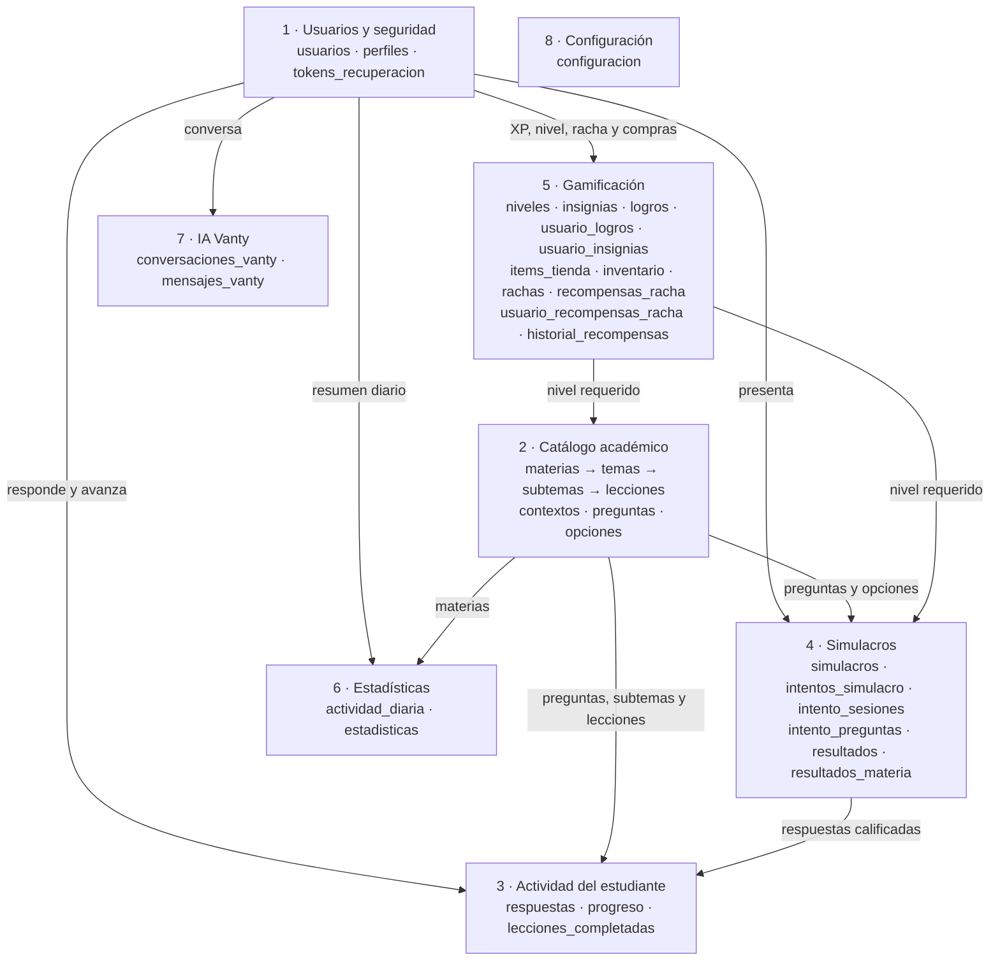
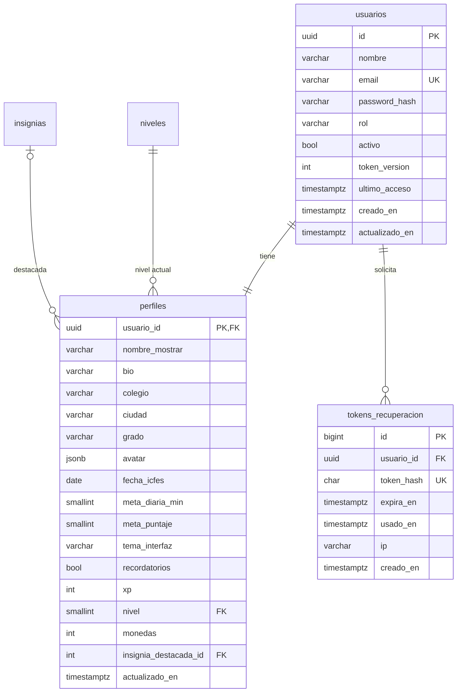
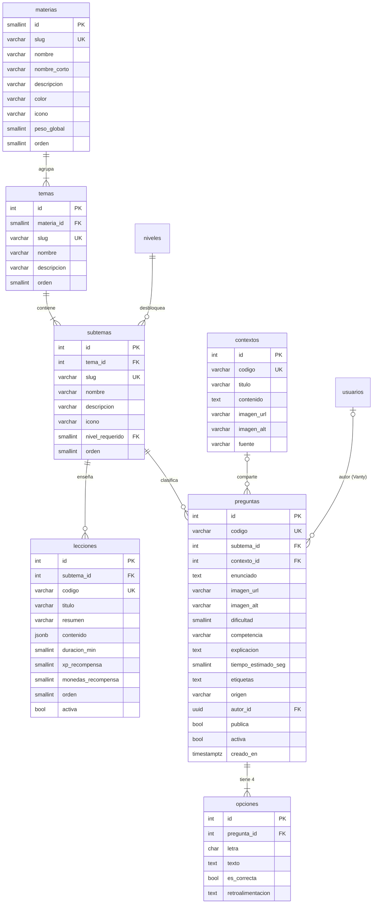
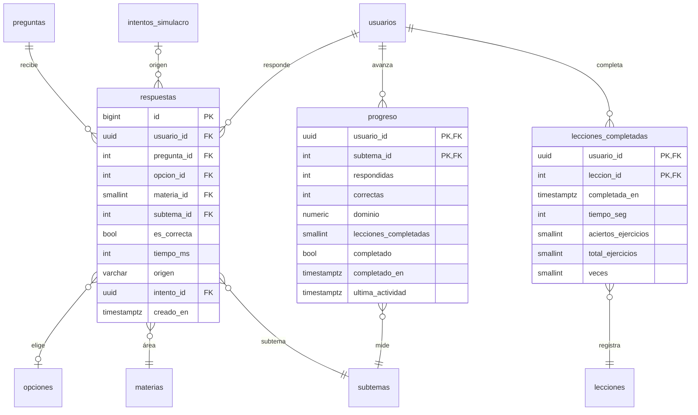
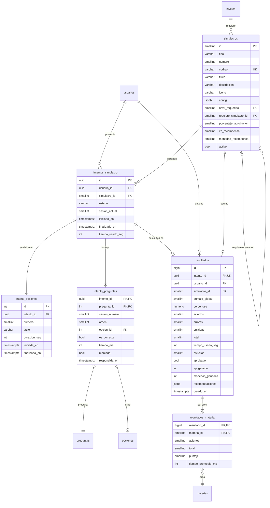
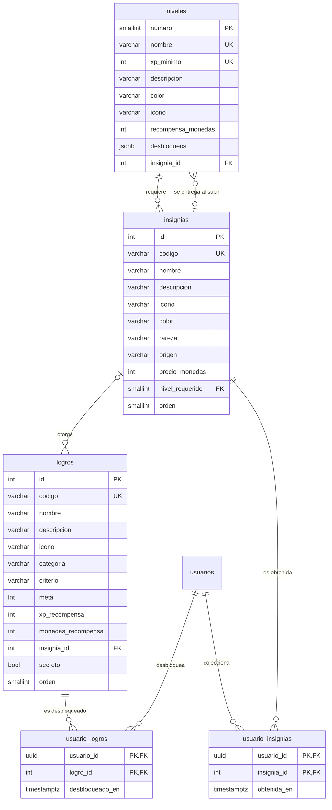
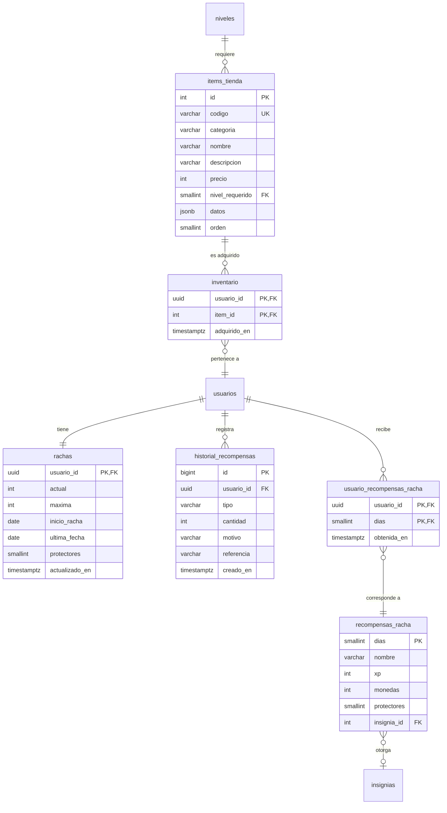
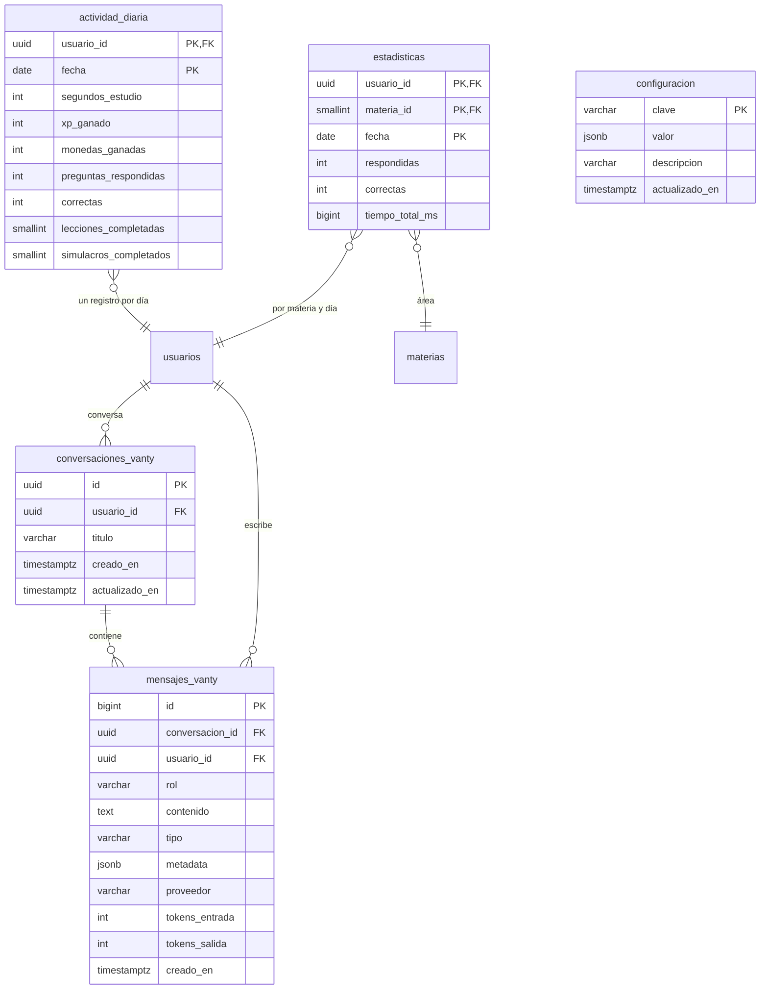

# Base de datos de ICFES Lab

**Motor:** PostgreSQL 13 o superior (usa `gen_random_uuid()`, incluido desde la versión 13).
**Scripts:** [`database/schema.sql`](../database/schema.sql) (estructura), [`database/seed.sql`](../database/seed.sql) (catálogo) y [`database/seed_contenido.sql`](../database/seed_contenido.sql) (preguntas y lecciones, generado desde los JSON).

| Módulo | Tablas |
|---|---|
| 1. Usuarios y seguridad | `usuarios`, `perfiles`, `tokens_recuperacion` |
| 2. Catálogo académico | `materias`, `temas`, `subtemas`, `lecciones`, `contextos`, `preguntas`, `opciones` |
| 3. Actividad del estudiante | `respuestas`, `progreso`, `lecciones_completadas` |
| 4. Simulacros | `simulacros`, `intentos_simulacro`, `intento_sesiones`, `intento_preguntas`, `resultados`, `resultados_materia` |
| 5. Gamificación | `niveles`, `insignias`, `logros`, `usuario_logros`, `usuario_insignias`, `items_tienda`, `inventario`, `rachas`, `recompensas_racha`, `usuario_recompensas_racha`, `historial_recompensas` |
| 6. Estadísticas | `actividad_diaria`, `estadisticas` |
| 7. IA Vanty | `conversaciones_vanty`, `mensajes_vanty` |
| 8. Configuración | `configuracion` |

En total: **35 tablas**, **2 vistas**, **3 funciones de trigger**, **7 triggers** y **26 índices** además de los que crean las llaves primarias y las restricciones `UNIQUE`.

**Convenciones:** nombres en español y `snake_case`; fechas con zona horaria (`TIMESTAMPTZ`); los días de estudio (`DATE`) se calculan en la zona horaria de la aplicación (`America/Bogota`); valores cerrados con `CHECK` en lugar de `ENUM`; identificadores `UUID` para las entidades expuestas en URLs (usuarios, intentos, conversaciones) y enteros `IDENTITY` para el catálogo.

> Las tablas mínimas solicitadas (`usuarios`, `perfiles`, `materias`, `temas`, `subtemas`, `preguntas`, `respuestas`, `simulacros`, `resultados`, `progreso`, `logros`, `rachas`, `estadisticas`, `mensajes_vanty`) existen con esos mismos nombres.

---

## Mapa de módulos



Todas las tablas de actividad, progreso, gamificación, estadísticas y Vanty pertenecen a un estudiante (`usuario_id → usuarios.id`, con borrado en cascada). `configuracion` no tiene relaciones: guarda la fecha global del ICFES y los límites de Vanty.

---

## Diagramas entidad-relación

Cardinalidades: `||` exactamente uno · `|o` cero o uno · `|{` uno o más · `o{` cero o más. Las entidades de otros módulos aparecen sin columnas.

### 1. Usuarios y seguridad



| Columna | Detalle |
|---|---|
| `usuarios.email` | Único sin distinguir mayúsculas (índice sobre `lower(email)`). |
| `usuarios.password_hash` | bcrypt con costo 12. |
| `usuarios.rol` | `estudiante` o `admin`. |
| `usuarios.token_version` | Al incrementarse invalida todos los JWT emitidos (cambio de contraseña, "cerrar todas las sesiones", desactivación). |
| `perfiles.avatar` | JSON con los códigos de los artículos equipados: `color`, `expresion`, `accesorio` y `fondo`. |
| `perfiles.grado` | `10`, `11`, `egresado` u `otro`. |
| `perfiles.fecha_icfes` | Fecha personal del examen; si es `NULL` se usa la global de `configuracion`. |
| `perfiles.meta_diaria_min` · `meta_puntaje` | 5 a 240 minutos · 0 a 500 puntos. |
| `perfiles.tema_interfaz` | `claro`, `oscuro` o `sistema`. |
| `perfiles.monedas` | Empieza en 50 y nunca puede ser negativo. |
| `tokens_recuperacion.token_hash` | SHA-256 del token (el token plano nunca se guarda). Vence en 1 hora y es de un solo uso (`usado_en`). |

### 2. Catálogo académico



| Columna | Detalle |
|---|---|
| `materias.slug` | `matematicas`, `lectura-critica`, `ciencias-naturales`, `sociales-ciudadanas`, `ingles`. |
| `materias.peso_global` | 3 en las áreas núcleo y 1 en Inglés (ponderación del puntaje global). |
| `subtemas.nivel_requerido` | Nivel del estudiante que desbloquea el subtema. |
| `lecciones.contenido` | Arreglo JSON de bloques: `texto`, `concepto`, `formula`, `ejemplo`, `lista`, `tip`, `ejercicio`. |
| `contextos` | Texto, tabla, gráfica o situación que comparten varias preguntas, como en el ICFES. |
| `preguntas.dificultad` | 1 baja, 2 media, 3 alta. |
| `preguntas.tiempo_estimado_seg` | 15 a 600 s; se usa para evaluar el ritmo del estudiante. |
| `preguntas.etiquetas` | Arreglo `TEXT[]` con índice GIN. |
| `preguntas.origen` · `autor_id` · `publica` | `banco`, `admin` o `vanty`. Las generadas por Vanty son privadas y tienen autor. |
| `opciones` | Exactamente 4 (letras A–D) y 1 correcta por pregunta, cada una con su retroalimentación. |

### 3. Actividad del estudiante



| Columna | Detalle |
|---|---|
| `respuestas` | Registro de **todas** las respuestas: práctica, lecciones, simulacros, retos y Vanty. |
| `respuestas.opcion_id` | `NULL` si la pregunta se omitió. |
| `respuestas.materia_id` · `subtema_id` | Desnormalizados a propósito para acelerar la analítica. |
| `respuestas.origen` | `practica`, `leccion`, `simulacro`, `reto` o `vanty`. |
| `respuestas.tiempo_ms` | Se contabilizan como máximo 5 minutos por pregunta. |
| `progreso.dominio` | 0 a 100: promedio móvil exponencial de aciertos (ver [GAMIFICACION.md](GAMIFICACION.md#dominio-y-práctica-adaptativa)). |
| `progreso.completado` | Todas las lecciones del subtema + dominio ≥ 60 con al menos 2 respuestas. |
| `lecciones_completadas.veces` | Veces que se completó o repasó la lección. |

### 4. Simulacros y resultados



| Columna | Detalle |
|---|---|
| `simulacros.tipo` | `completo`, `mini` o `reto`. `(tipo, numero)` es único. |
| `simulacros.config` | JSON con las sesiones (título, duración y preguntas por área), el rango de dificultad y la estrategia de selección: `fija` (con semilla), `aleatoria`, `adaptativa` o `materia_debil`. |
| `simulacros.requiere_simulacro_id` | Minisimulacro anterior del camino (el n requiere el n − 1). |
| `simulacros.porcentaje_aprobacion` | Porcentaje de aciertos para superar un reto. |
| `intentos_simulacro.estado` | `en_curso`, `finalizado` o `abandonado`. Solo puede haber un intento en curso por simulacro y estudiante. |
| `intento_sesiones.iniciada_en` · `duracion_seg` | Cronómetro controlado por el servidor. `(intento_id, numero)` es único. |
| `intento_preguntas` | Autoguardado de la opción, la marca de revisión y el tiempo. `es_correcta` se calcula al calificar. |
| `resultados` | Puntaje global 0–500, porcentaje, estrellas 0–3, recompensas y recomendaciones (JSON). Siempre `aciertos + errores + omitidas = total`. |
| `resultados_materia.puntaje` | Puntaje del área de 0 a 100. |

### 5a. Niveles, logros e insignias



| Columna | Detalle |
|---|---|
| `niveles.xp_minimo` | 0 · 400 · 1500 · 4500 · 10 000 (Principiante → Maestro ICFES). |
| `niveles.desbloqueos` | Lista (JSON) de lo que desbloquea el nivel, para mostrarla al estudiante. |
| `niveles.insignia_id` · `insignias.nivel_requerido` | Relación circular: la insignia que entrega cada nivel y el nivel que exige cada insignia. Se resuelve con `ALTER TABLE` en `schema.sql`. |
| `insignias.rareza` · `origen` | `comun`, `rara`, `epica`, `legendaria` · `logro`, `nivel`, `tienda`, `racha`. Solo las de tienda tienen precio. |
| `logros.criterio` · `meta` | Métrica que evalúa el motor de logros (por ejemplo `correctas_total`) y el valor que hay que alcanzar. |
| `logros.categoria` | `constancia`, `precision`, `simulacros`, `progreso`, `social` o `especial`. |
| `logros.secreto` | Nombre y condición ocultos hasta desbloquearlo. |

### 5b. Tienda, rachas e historial



| Columna | Detalle |
|---|---|
| `items_tienda.categoria` | `color`, `expresion`, `accesorio`, `fondo` o `protector`. |
| `items_tienda.precio` | 0 = se entrega gratis al registrarse (trigger de alta). |
| `items_tienda.datos` | Colores y formas que usa el avatar SVG (JSON). |
| `rachas.maxima` | Récord del estudiante (siempre ≥ `actual`). |
| `rachas.protectores` | 0 a 3; cubren automáticamente días sin estudio. |
| `recompensas_racha.dias` | Hitos de 3, 7, 14, 30, 60 y 100 días. |
| `historial_recompensas` | Libro de movimientos de XP y monedas (`tipo`), con motivo y referencia. Las compras tienen cantidad negativa. |

### 6–8. Estadísticas, Vanty y configuración



| Columna | Detalle |
|---|---|
| `actividad_diaria.fecha` | Día en la zona horaria de la aplicación. Alimenta el calendario, las horas por semana y la racha. |
| `estadisticas` | Agregado diario por materia (respuestas, aciertos y tiempo) para la evolución semanal y mensual. |
| `conversaciones_vanty.titulo` | Se toma del primer mensaje del estudiante. |
| `mensajes_vanty.rol` · `tipo` | `usuario` o `vanty` · `texto`, `pregunta`, `recomendacion` o `explicacion`. |
| `mensajes_vanty.metadata` | Pregunta de las tarjetas interactivas, pregunta adjunta, modelo usado. |
| `mensajes_vanty.proveedor` · `tokens_*` | `claude` o `local` · consumo de la API por respuesta. |
| `configuracion` | Clave → valor JSON: `fecha_icfes` (fecha global del examen) y `vanty` (límite diario de mensajes). |

---

## Llaves foráneas y reglas de borrado

| Tabla.columna | Referencia | Al borrar el padre |
|---|---|---|
| `perfiles.usuario_id`, `rachas.usuario_id` | `usuarios.id` | `CASCADE` (relación 1:1, también son la PK) |
| `tokens_recuperacion.usuario_id`, `respuestas.usuario_id`, `progreso.usuario_id`, `lecciones_completadas.usuario_id`, `intentos_simulacro.usuario_id`, `resultados.usuario_id`, `usuario_logros.usuario_id`, `usuario_insignias.usuario_id`, `inventario.usuario_id`, `usuario_recompensas_racha.usuario_id`, `historial_recompensas.usuario_id`, `actividad_diaria.usuario_id`, `estadisticas.usuario_id`, `conversaciones_vanty.usuario_id`, `mensajes_vanty.usuario_id` | `usuarios.id` | `CASCADE`: eliminar la cuenta borra todos sus datos |
| `preguntas.autor_id` | `usuarios.id` | `CASCADE` (solo lo usan las preguntas privadas generadas por Vanty) |
| `perfiles.nivel`, `subtemas.nivel_requerido`, `insignias.nivel_requerido`, `items_tienda.nivel_requerido`, `simulacros.nivel_requerido` | `niveles.numero` | `NO ACTION` |
| `perfiles.insignia_destacada_id`, `niveles.insignia_id`, `logros.insignia_id`, `recompensas_racha.insignia_id` | `insignias.id` | `SET NULL` |
| `temas.materia_id` | `materias.id` | `CASCADE` |
| `subtemas.tema_id` | `temas.id` | `CASCADE` |
| `lecciones.subtema_id` | `subtemas.id` | `CASCADE` |
| `preguntas.subtema_id` | `subtemas.id` | `RESTRICT`: no se puede borrar un subtema con preguntas |
| `preguntas.contexto_id` | `contextos.id` | `SET NULL` |
| `opciones.pregunta_id` | `preguntas.id` | `CASCADE` |
| `respuestas.pregunta_id` | `preguntas.id` | `CASCADE` |
| `respuestas.opcion_id` | `opciones.id` | `SET NULL` |
| `respuestas.materia_id`, `resultados_materia.materia_id` | `materias.id` | `NO ACTION` |
| `estadisticas.materia_id` | `materias.id` | `CASCADE` |
| `respuestas.subtema_id` | `subtemas.id` | `NO ACTION` |
| `progreso.subtema_id` | `subtemas.id` | `CASCADE` |
| `respuestas.intento_id` | `intentos_simulacro.id` | `SET NULL` |
| `lecciones_completadas.leccion_id` | `lecciones.id` | `CASCADE` |
| `simulacros.requiere_simulacro_id` | `simulacros.id` | `NO ACTION` |
| `intentos_simulacro.simulacro_id`, `resultados.simulacro_id` | `simulacros.id` | `NO ACTION` |
| `intento_sesiones.intento_id`, `intento_preguntas.intento_id`, `resultados.intento_id` | `intentos_simulacro.id` | `CASCADE` |
| `intento_preguntas.pregunta_id` / `.opcion_id` | `preguntas.id` / `opciones.id` | `NO ACTION` |
| `resultados_materia.resultado_id` | `resultados.id` | `CASCADE` |
| `usuario_logros.logro_id` | `logros.id` | `CASCADE` |
| `usuario_insignias.insignia_id` | `insignias.id` | `CASCADE` |
| `inventario.item_id` | `items_tienda.id` | `CASCADE` |
| `usuario_recompensas_racha.dias` | `recompensas_racha.dias` | `CASCADE` |
| `mensajes_vanty.conversacion_id` | `conversaciones_vanty.id` | `CASCADE` |

Las preguntas del banco nunca se borran físicamente: el panel de administración las **desactiva** (`activa = false`) para conservar el historial de respuestas y simulacros.

---

## Índices

Además de los índices de las llaves primarias y de las restricciones `UNIQUE`:

| Índice | Definición | Para qué sirve |
|---|---|---|
| `usuarios_email_uq` | `UNIQUE (lower(email))` | Correo único sin distinguir mayúsculas; login. |
| `tokens_recuperacion_usuario_idx` | `(usuario_id, creado_en DESC)` | Invalidar tokens anteriores. |
| `temas_materia_idx` | `(materia_id, orden)` | Árbol de la materia. |
| `subtemas_tema_idx` | `(tema_id, orden)` | Árbol de la materia. |
| `lecciones_subtema_idx` | `(subtema_id, orden) WHERE activa` | Lecciones de un subtema. |
| `preguntas_subtema_idx` | `(subtema_id, dificultad) WHERE activa AND publica` | Práctica adaptativa y selección de simulacros. |
| `preguntas_contexto_idx` | `(contexto_id) WHERE contexto_id IS NOT NULL` | Agrupar preguntas con contexto compartido. |
| `preguntas_autor_idx` | `(autor_id) WHERE autor_id IS NOT NULL` | Preguntas privadas de Vanty. |
| `preguntas_etiquetas_gin` | `GIN (etiquetas)` | Búsqueda por etiquetas. |
| `opciones_una_correcta_uq` | `UNIQUE (pregunta_id) WHERE es_correcta` | Como máximo una opción correcta. |
| `intentos_usuario_idx` | `(usuario_id, iniciado_en DESC)` | Historial de intentos. |
| `intentos_en_curso_uq` | `UNIQUE (usuario_id, simulacro_id) WHERE estado = 'en_curso'` | Un solo intento en curso por simulacro (permite reanudar). |
| `intento_preguntas_orden_idx` | `(intento_id, sesion_numero, orden)` | Cargar una sesión en orden. |
| `respuestas_usuario_fecha_idx` | `(usuario_id, creado_en DESC)` | Actividad reciente, ventanas de 30/60/90 días. |
| `respuestas_usuario_materia_idx` | `(usuario_id, materia_id, creado_en DESC)` | Rendimiento por área. |
| `respuestas_usuario_subtema_idx` | `(usuario_id, subtema_id)` | Rendimiento por subtema. |
| `respuestas_usuario_pregunta_idx` | `(usuario_id, pregunta_id, creado_en DESC)` | Historial por pregunta (repaso espaciado, XP reducido). |
| `respuestas_intento_idx` | `(intento_id) WHERE intento_id IS NOT NULL` | Respuestas de un simulacro. |
| `resultados_usuario_idx` | `(usuario_id, creado_en DESC)` | Historial de resultados. |
| `resultados_simulacro_idx` | `(usuario_id, simulacro_id)` | Mejor puntaje y desbloqueo del camino. |
| `items_tienda_categoria_idx` | `(categoria, orden)` | Catálogo de la tienda. |
| `historial_recompensas_usuario_idx` | `(usuario_id, creado_en DESC)` | Libro de movimientos. |
| `estadisticas_usuario_fecha_idx` | `(usuario_id, fecha)` | Evolución semanal y mensual. |
| `conversaciones_vanty_usuario_idx` | `(usuario_id, actualizado_en DESC)` | Lista de conversaciones. |
| `mensajes_vanty_conversacion_idx` | `(conversacion_id, id)` | Mensajes de una conversación en orden. |
| `mensajes_vanty_usuario_fecha_idx` | `(usuario_id, creado_en DESC)` | Límite diario de mensajes. |

---

## Reglas de integridad

**Restricciones `UNIQUE` destacadas:** `materias.slug`, `temas.slug`, `subtemas.slug`, `preguntas.codigo`, `lecciones.codigo`, `contextos.codigo`, `simulacros.codigo`, `(simulacros.tipo, numero)`, `(opciones.pregunta_id, letra)`, `(intento_sesiones.intento_id, numero)`, `resultados.intento_id`, `niveles.nombre`, `niveles.xp_minimo`, `insignias.codigo`, `logros.codigo`, `items_tienda.codigo`, `tokens_recuperacion.token_hash`.

**Restricciones `CHECK` destacadas:**

| Tabla | Regla |
|---|---|
| `usuarios` | Nombre de al menos 2 caracteres; el correo contiene `@`; `rol` ∈ {estudiante, admin}. |
| `perfiles` | `xp ≥ 0`, `monedas ≥ 0` (una compra sin saldo falla), meta diaria entre 5 y 240 min, meta de puntaje entre 0 y 500. |
| `insignias` | `insignias_precio_tienda_ck`: solo las insignias de tienda tienen precio. |
| `preguntas` | Dificultad 1–3, tiempo estimado 15–600 s; `preguntas_vanty_privadas_ck`: una pregunta de Vanty siempre es privada y tiene autor. |
| `lecciones` | `contenido` debe ser un arreglo JSON. |
| `progreso` | `dominio` entre 0 y 100; `correctas ≤ respondidas`. |
| `resultados` | Puntaje global 0–500, estrellas 0–3; `aciertos + errores + omitidas = total`. |
| `rachas` | `maxima ≥ actual`; protectores entre 0 y 3. |
| `historial_recompensas` | `cantidad ≠ 0`; `tipo` ∈ {xp, monedas}. |
| `estadisticas` | `correctas ≤ respondidas`. |

---

## Triggers y funciones

| Función | Trigger | Momento | Qué hace |
|---|---|---|---|
| `tg_set_actualizado_en()` | `usuarios_actualizado_en`, `perfiles_actualizado_en`, `conversaciones_vanty_actualizado_en`, `configuracion_actualizado_en` | `BEFORE UPDATE` | Actualiza la columna `actualizado_en`. |
| `tg_validar_opciones_pregunta()` | `preguntas_opciones_validas` (en `preguntas`), `opciones_validas` (en `opciones`) | `CONSTRAINT TRIGGER … DEFERRABLE INITIALLY DEFERRED` | Al confirmar la transacción, cada pregunta debe tener **exactamente 4 opciones y 1 correcta**. Al ser diferido, permite insertar la pregunta y luego sus opciones dentro de la misma transacción. |
| `tg_usuario_inicial()` | `usuarios_alta_inicial` | `AFTER INSERT` en `usuarios` | Crea el perfil (con el primer nombre como nombre visible), la racha y el inventario inicial con los artículos gratuitos de la tienda. |

## Vistas

| Vista | Columnas | Uso |
|---|---|---|
| `v_rendimiento_materia` | `usuario_id, materia_id, materia_slug, materia, respondidas, correctas, precision, tiempo_promedio_ms` | Rendimiento acumulado por estudiante y materia (reportes y consultas ad hoc). |
| `v_rendimiento_subtema` | `usuario_id, subtema_id, subtema_slug, subtema, materia_id, respondidas, correctas, precision, tiempo_promedio_ms` | Rendimiento acumulado por estudiante y subtema. |

---

## Datos iniciales

`seed.sql` es **idempotente** (usa `INSERT … ON CONFLICT DO UPDATE`), así que se puede volver a ejecutar para actualizar el catálogo sin perder datos de los estudiantes.

| Catálogo | Cantidad | Detalle |
|---|---|---|
| Niveles | 5 | Principiante (0 XP), Explorador (400), Avanzado (1500), Experto (4500), Maestro ICFES (10 000). |
| Insignias | 19 | 4 de nivel, 3 de racha, 6 de logros, 6 de tienda. |
| Materias / temas / subtemas | 5 / 15 / 25 | Los 25 subtemas pedidos; 10 se desbloquean en los niveles 2 y 3. |
| Logros | 21 | Constancia, precisión, simulacros, progreso, social y 2 secretos. |
| Artículos de tienda | 33 | 9 colores, 7 expresiones, 8 accesorios, 8 fondos y el protector de racha. |
| Recompensas de racha | 6 | 3, 7, 14, 30, 60 y 100 días. |
| Plantillas de simulacro | 26 | 10 completos, 10 minisimulacros encadenados y 6 retos. |
| Configuración | 2 claves | `fecha_icfes` (fecha global del examen) y `vanty` (límite diario de mensajes). |

`seed_contenido.sql` (o `npm run db:seed`) carga el contenido académico de `database/contenido/`: **50 preguntas** (200 opciones, 39 contextos y 7 imágenes) y **25 lecciones**. El formato está documentado en [FORMATO.md](../database/contenido/FORMATO.md).

---

## Instalación

### Con Node (recomendado)

```bash
npm run db:setup
```

Crea la base de datos si el usuario tiene permiso `CREATEDB`, aplica `schema.sql` solo si las tablas no existen, aplica `seed.sql` y carga el contenido JSON. `npm run db:reset` borra el esquema `public` y lo recrea desde cero.

### Solo con psql

```bash
createdb -U postgres -E UTF8 -T template0 icfeslab
psql -U postgres -d icfeslab -v ON_ERROR_STOP=1 -f database/schema.sql -f database/seed.sql -f database/seed_contenido.sql
```

Los tres archivos declaran `SET client_encoding = 'UTF8'`, así que las tildes se conservan aunque la consola de Windows use otra página de códigos. Si cambias los JSON de contenido, regenera `seed_contenido.sql` con `npm run db:sql`.

### Crear un administrador

```bash
npm run admin:crear -- --email admin@colegio.edu.co --nombre "Ana Pérez" --password "Clave2026"
```

Si el correo ya existe, la cuenta se promueve a administradora.

---

## Consultas útiles

```sql
-- Rendimiento de un estudiante por materia
SELECT materia, respondidas, precision, tiempo_promedio_ms
  FROM v_rendimiento_materia
 WHERE usuario_id = (SELECT id FROM usuarios WHERE lower(email) = 'demo@icfeslab.co');

-- Top 10 de XP
SELECT u.nombre, p.xp, n.nombre AS nivel, r.actual AS racha
  FROM perfiles p
  JOIN usuarios u ON u.id = p.usuario_id
  JOIN niveles n ON n.numero = p.nivel
  JOIN rachas r ON r.usuario_id = p.usuario_id
 ORDER BY p.xp DESC
 LIMIT 10;

-- Preguntas con menor tasa de acierto (candidatas a revisión)
SELECT q.codigo, count(*) AS respuestas,
       round(100.0 * count(*) FILTER (WHERE r.es_correcta) / count(*), 1) AS acierto
  FROM respuestas r JOIN preguntas q ON q.id = r.pregunta_id
 WHERE q.origen <> 'vanty'
 GROUP BY q.codigo
HAVING count(*) >= 20
 ORDER BY acierto
 LIMIT 10;

-- Uso de Vanty por proveedor (últimos 30 días)
SELECT proveedor, count(*) AS mensajes, sum(tokens_entrada) AS tokens_entrada, sum(tokens_salida) AS tokens_salida
  FROM mensajes_vanty
 WHERE rol = 'vanty' AND creado_en > now() - interval '30 days'
 GROUP BY proveedor;
```
