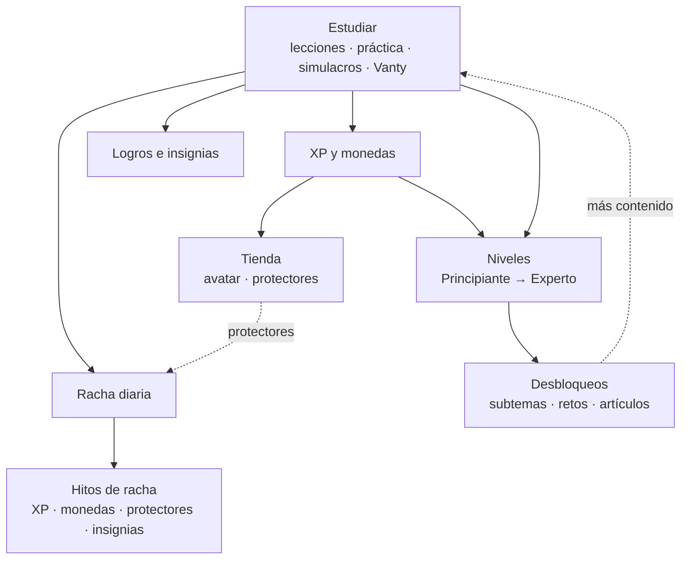

# Gamificación, puntajes y reglas

Todas las cantidades de este documento están centralizadas en [`backend/src/config/reglas.js`](../backend/src/config/reglas.js) (reglas del juego) y [`database/seed.sql`](../database/seed.sql) (catálogo: niveles, logros, tienda, rachas y simulacros). Se pueden ajustar sin tocar la lógica.

## El ciclo



Cada acción de estudio devuelve **eventos** (`+XP`, `+monedas`, subida de nivel, racha, logro, subtema completado…) que el frontend muestra como notificaciones y con confeti en los momentos importantes.

---

## XP (experiencia)

| Acción | XP |
|---|---|
| Respuesta correcta en práctica, lección o Vanty | **5** (dificultad baja) · **6** (media) · **8** (alta) |
| Respuesta incorrecta | **1** (se premia el esfuerzo) |
| Volver a acertar una pregunta ya acertada en las últimas 24 h | **1** (y sin monedas) |
| Primer estudio del día (mantener la racha) | **10** |
| Completar una lección por primera vez | La recompensa de la lección (**30** por defecto) |
| Repasar una lección ya completada | **5** |
| Completar un subtema (todas sus lecciones + dominio ≥ 60 %) | **100** |
| Terminar un simulacro | Recompensa del simulacro **+ 2 por cada acierto** (ver [Simulacros](#simulacros-minisimulacros-y-retos)) |
| Desbloquear un logro | Según el logro (20 a 1000) |
| Alcanzar un hito de racha | Según el hito (30 a 1000) |

## Niveles

Hay 4 niveles; el máximo es **Experto**. Para subir no basta la XP: hay que cumplir **todos** los requisitos académicos del nivel, que se definen en `niveles.requisitos` (`database/seed.sql`) y se calculan en [`niveles.service.js`](../backend/src/services/niveles.service.js).

| Nivel | Nombre | XP | Días de estudio | Preguntas respondidas | Aciertos | Temas completados en **cada** área | Actividades completadas | Monedas | Insignia |
|---|---|---|---|---|---|---|---|---|---|
| 1 | Principiante | 0 | — | — | — | — | — | — | — |
| 2 | Explorador | 1000 | 7 | 150 | 55 % | 25 % | — | 30 | Explorador (rara) |
| 3 | Avanzado | 4000 | 25 | 600 | 65 % | 60 % | 50 % | 60 | Avanzado (rara) |
| 4 | Experto | 9000 | 45 | 1000 | 75 % | 85 % | **90 %** | 100 | Experto (épica) |

- **Temas completados:** lección del tema hecha y dominio ≥ 60 %. Se exige en cada una de las 5 áreas del temario vigente: Lectura Crítica (7 temas), Matemáticas (12), Sociales y Ciudadanas (16), Ciencias Naturales (40) e Inglés (9).
- **Actividades de la plataforma:** las 84 lecciones, los 84 temas, los 10 minisimulacros, los 5 simulacros completos y los 5 retos (188 en total). **Experto** exige el 90 % de todas ellas.
- **Aciertos:** porcentaje de respuestas correctas sobre todas las respuestas (práctica, lecciones, simulacros, retos y Vanty).
- Los niveles se alcanzan en orden y **nunca se pierden**: quien ya estaba en un nivel lo conserva aunque los requisitos hayan subido. El nivel 5 (Maestro ICFES) se eliminó: quien estaba en él quedó en Experto con su XP, logros e insignias.
- En **Logros → Niveles** el estudiante ve los requisitos del siguiente nivel con su avance (por ejemplo, «Temario en cada área · 18 % de 25 %», con el detalle por área), y en el Inicio cuántos requisitos lleva.

| Nivel | Desbloquea |
|---|---|
| 1 | 70 temas del temario de las 5 áreas, camino de minisimulacros, los 5 simulacros completos, retos Relámpago y Supera tu punto débil. |
| 2 | Los 14 temas de continuación (II y III) de Matemáticas, Ciencias Naturales y Sociales y Ciudadanas · reto Precisión · fondo Circuitos. |
| 3 | Reto Maratón mixta · Birrete de grado, Ojos de estrella, fondo Aurora. |
| 4 | Reto Desafío Experto · color Dorado, Galaxia, Modo genio, Corona y fondo Rayos dorados. |

## Monedas

Cada estudiante empieza con **50 monedas** y los artículos gratuitos de la tienda.

| Fuente | Monedas |
|---|---|
| Respuesta correcta (no repetida en 24 h) | 1 |
| Lección completada por primera vez | 5 por defecto |
| Subtema completado | 20 |
| Minisimulacro | 15 + 5 por estrella |
| Simulacro completo | 50 |
| Reto superado | Según el reto (20 a 120) + 5 por estrella |
| Subir de nivel | 30 · 60 · 100 · 200 |
| Logros e hitos de racha | Según el logro o hito |

Se gastan en la [tienda](#tienda). Cada movimiento de XP y monedas queda registrado en `historial_recompensas` (las compras con cantidad negativa).

---

## Rachas

- Un **día de estudio** es cualquier día (en la zona horaria de la aplicación, `America/Bogota`) en que el estudiante responde una pregunta, completa una lección, termina un simulacro o le hace a Vanty una consulta académica (duda, explicación, pregunta de práctica o estrategia).
- Si estudió **ayer**, la racha sube 1. El primer estudio de cada día otorga 10 XP.
- Si faltó `n` días y tiene **al menos `n` protectores**, se consumen automáticamente y la racha continúa.
- Si faltó más días de los que cubren sus protectores, la racha vuelve a 1.
- La racha **está en riesgo** cuando el estudiante tiene una racha activa pero aún no ha estudiado hoy. El dashboard y Vanty lo avisan.
- Se guarda el **récord** (`maxima`) y la fecha de inicio de la racha actual.

**Protectores de racha.** Máximo 3 a la vez. Se compran en la tienda (100 monedas) o se ganan en los hitos de 7, 14, 30, 60 y 100 días.

**Hitos de racha** (se entregan una sola vez):

| Días | Nombre | XP | Monedas | Protectores | Insignia |
|---|---|---|---|---|---|
| 3 | Chispa | 30 | 10 | — | — |
| 7 | Semana de fuego | 70 | 25 | 1 | Llama semanal |
| 14 | Dos semanas imparables | 150 | 40 | 1 | — |
| 30 | Mes de campeón | 300 | 100 | 2 | Fuego constante |
| 60 | Constancia de acero | 500 | 150 | 2 | — |
| 100 | Llama eterna | 1000 | 300 | 3 | Llama eterna |

**Calendario de actividad.** Mapa de calor por día: sin estudio · menos de 15 min · menos de 30 min · menos de 60 min · 60 min o más.

---

## Logros

Se evalúan después de cada acción. Como un logro puede subir de nivel al estudiante (y eso desbloquear otro logro), la evaluación se repite hasta que no haya novedades.

| Logro | Condición | XP | Monedas | Insignia |
|---|---|---|---|---|
| Primeros pasos | Responder la primera pregunta | 20 | 5 | — |
| Aprendiz | Completar la primera lección | 30 | 10 | — |
| Primera semana de estudio | Racha de 7 días | 100 | 30 | — |
| Imparable | Racha de 30 días | 300 | 100 | — |
| Leyenda de la constancia | Racha de 100 días | 1000 | 300 | — |
| 100 preguntas correctas | 100 respuestas correctas | 150 | 40 | Centenario |
| Máquina de aciertos | 500 respuestas correctas | 500 | 120 | — |
| Primer simulacro | Completar un simulacro o minisimulacro | 50 | 15 | — |
| 10 simulacros completados | 10 simulacros o minisimulacros | 300 | 80 | Veterano |
| Barrera de los 300 | 300 puntos o más en un simulacro completo | 200 | 60 | — |
| Perfeccionista | 100 % en un minisimulacro | 150 | 50 | Perfeccionista |
| Retador | Superar un reto | 80 | 20 | — |
| Todoterreno | Responder preguntas de las 5 áreas | 80 | 20 | Todoterreno |
| Dominio total | Dominio ≥ 80 % en un subtema (con 2+ respuestas) | 100 | 30 | — |
| Estudiante dedicado | Completar 25 lecciones | 250 | 60 | — |
| Nivel Experto | Alcanzar el nivel 4 | — | 100 | — |
| Buen conversador | Enviar 10 mensajes a Vanty | 50 | 15 | — |
| Estilo propio | Comprar el primer artículo | 30 | — | — |
| Madrugador 🔒 | Estudiar entre las 4:00 y las 6:59 a. m. | 40 | 10 | Madrugador |
| Búho nocturno 🔒 | Estudiar entre las 10:00 p. m. y las 3:59 a. m. | 40 | 10 | Búho nocturno |
| Fecha en la mira | Elegir el calendario del ICFES (A o B) | 20 | 5 | — |
| Primeros temas | Completar 5 temas del temario | 80 | 20 | — |
| Un tercio del temario | Completar 25 temas | 250 | 60 | — |
| Explorador de áreas | Completar al menos un tema en cada una de las 5 áreas | 120 | 30 | — |
| Área dominada | Completar todos los temas de un área | 300 | 80 | — |
| Temario completo | Completar todos los temas del temario | 800 | 200 | — |
| Lector incansable | Completar 50 lecciones | 300 | 70 | — |
| Prueba de fuego | Terminar el primer simulacro completo | 150 | 40 | — |
| Simulacros al día | Terminar los 5 simulacros completos | 500 | 120 | — |
| Camino recorrido | Completar los 10 minisimulacros | 300 | 80 | — |
| Club de los 400 | 400 puntos o más en un simulacro completo | 400 | 100 | — |
| Retador total | Superar los 5 retos | 300 | 80 | — |
| Mil aciertos | 1000 respuestas correctas | 700 | 150 | — |
| Puntería fina | 70 % de aciertos con 200 respuestas o más | 200 | 50 | — |
| 30 días de estudio | Estudiar 30 días distintos | 200 | 50 | — |
| 100 días de estudio | Estudiar 100 días distintos | 600 | 150 | — |
| Nivel Explorador | Alcanzar el nivel 2 | — | 20 | — |
| Nivel Avanzado | Alcanzar el nivel 3 | — | 50 | — |

🔒 Logros secretos: su nombre y condición se ocultan hasta desbloquearlos.

En total hay **38 logros**. Los nuevos se entregan también a quien ya cumplía la condición, en su siguiente acción. El logro «Maestro ICFES» se retiró junto con el nivel 5: quien lo había desbloqueado lo conserva (`logros.activo = FALSE` solo lo oculta para los demás).

## Insignias

12 insignias con rareza común, rara, épica o legendaria. **Ya no se compran:** se ganan con niveles, rachas y logros.

| Origen | Insignias |
|---|---|
| Niveles (3) | Explorador, Avanzado, Experto |
| Rachas (3) | Llama semanal (7 días), Fuego constante (30), Llama eterna (100) |
| Logros (6) | Centenario, Perfeccionista, Veterano, Todoterreno, Madrugador, Búho nocturno |

Las 6 insignias que antes vendía la tienda y la del nivel Maestro quedaron con `insignias.activa = FALSE`: quien las tenía las conserva y las sigue viendo en su colección; los demás ya no las ven.

El estudiante puede **destacar** una insignia en su perfil.

## Tienda

| Categoría | Artículos | Precios |
|---|---|---|
| Color del avatar | Lima, Cielo, Índigo (gratis) · Durazno, Menta, Lavanda, Coral · Dorado y Galaxia (nivel 4) | 0–400 |
| Expresión | Feliz, Sonriente (gratis) · Guiño, Concentrado, Asombro · Ojos de estrella (nivel 3) · Modo genio (nivel 4) | 0–200 |
| Accesorio | Sin accesorio (gratis) · Moño, Gafas de estudio, Gorra, Antenas, Audífonos · Birrete de grado (nivel 3) · Corona (nivel 4) | 0–500 |
| Fondo | Índigo, Cielo, Lima suave (gratis) · Atardecer, Noche estrellada · Circuitos (nivel 2) · Aurora (nivel 3) · Rayos dorados (nivel 4) | 0–350 |
| Protector de racha | Mantiene la racha un día sin estudio (máximo 3) | 100 |

La tienda ya no vende insignias (la API rechaza `tipo: "insignia"`).

El avatar se compone con un artículo de cada categoría (color, expresión, accesorio y fondo) y solo se pueden equipar artículos del inventario. Una compra sin saldo suficiente falla sin descontar nada.

---

## Simulacros, minisimulacros y retos

| Tipo | Cantidad | Estructura | Selección de preguntas | Recompensa (primera vez) |
|---|---|---|---|---|
| **Simulacro completo** | 5 | 2 sesiones de 4 h 30 min. Primera sesión (120): Lectura Crítica 41, Matemáticas 25, Sociales y Ciudadanas 25, Ciencias Naturales 29. Segunda sesión (134): Matemáticas 25, Sociales y Ciudadanas 25, Ciencias Naturales 29, Inglés 55. Total: 254. | Fija con semilla: el mismo simulacro tiene las mismas preguntas para todos. | 200 XP + 2 XP por acierto · 50 monedas |
| **Minisimulacro** (camino) | 10 | 1 sesión de 30 min. 1–3: 20 preguntas (dificultad baja y media); 4–7: 25 (todas); 8–10: 30 (media y alta). | Adaptativa: prioriza preguntas no vistas o falladas y subtemas débiles. Cada uno se desbloquea al completar el anterior. | 60 a 105 XP + 2 por acierto · 15 monedas + 5 por estrella |
| **Reto** | 5 | Ver tabla de retos. | Aleatoria, por área débil o por dificultad. | Solo si se supera el porcentaje de aprobación |

**Con el banco actual** (252 preguntas: 21 de Lectura Crítica, 36 de Matemáticas, 48 de Sociales, 120 de Ciencias y 27 de Inglés), cada simulacro completo arma 190 de sus 254 preguntas y la duración se ajusta al ritmo del examen real (6 h 44 min en total); las tarjetas lo indican («190 de 254 preguntas»). Cuando el banco tenga al menos 41 preguntas de Lectura Crítica, 50 de Matemáticas, 50 de Sociales, 58 de Ciencias y 55 de Inglés, los simulacros tendrán la extensión y los tiempos completos sin cambiar el código. Los simulacros 6 a 10 de versiones anteriores quedaron inactivos (sus resultados se conservan).

**Retos por nivel:**

| Reto | Nivel | Preguntas | Tiempo | Aprobación | Recompensa |
|---|---|---|---|---|---|
| Relámpago | 1 | 10 mixtas, dificultad baja y media | 8 min | 60 % | 80 XP · 20 monedas |
| Supera tu punto débil | 1 | 10 de tu área con menor precisión | 15 min | 60 % | 80 XP · 20 monedas |
| Precisión | 2 | 12 mixtas | 15 min | 80 % | 120 XP · 30 monedas |
| Maratón mixta | 3 | 20 (4 por área) | 25 min | 70 % | 180 XP · 45 monedas |
| Desafío Experto | 4 | 15 de dificultad alta | 20 min | 70 % | 250 XP · 70 monedas |

El reto «Maestro ICFES» se retiró con el nivel 5 (sus resultados se conservan).

**Reglas comunes:**

- El **cronómetro lo controla el servidor**. Si una sesión vence sin que el estudiante la cierre, se cierra sola y las preguntas sin responder cuentan como omitidas. Hay 10 s de gracia para la latencia de red.
- Las respuestas se **autoguardan**; el intento se puede reanudar (un solo intento en curso por simulacro).
- Las preguntas que comparten un contexto se mantienen juntas; el resto se mezcla entre áreas.
- Primero se eligen preguntas del rango de dificultad de la plantilla; si no alcanzan, se completa con otras dificultades.
- **Estrellas:** 1 estrella con 50 % de aciertos, 2 con 70 % y 3 con 90 %.
- **Repeticiones:** repetir un simulacro otorga el 25 % de las recompensas. En los retos no superados solo se gana el bono de 2 XP por acierto (reducido si es una repetición).
- El resultado incluye puntaje global y por área, aciertos, errores, omitidas, tiempo usado, comparación con el intento anterior, hasta 5 **recomendaciones automáticas** (área débil con su subtema más fallado, preguntas en blanco, ritmo, siguiente paso y repaso con Vanty) y la revisión pregunta por pregunta con explicaciones.

---

## Puntajes tipo Saber 11

### Puntaje por área (0–100)

Porcentaje de aciertos **ponderado por dificultad** (baja 1 · media 1,25 · alta 1,5):

```
puntaje_área = 100 × Σ(peso de las correctas) / Σ(peso de todas)
```

### Puntaje global (0–500)

Igual que el ICFES: promedio ponderado de las áreas (Matemáticas, Lectura Crítica, Sociales y Ciudadanas y Ciencias Naturales pesan 3; Inglés pesa 1) multiplicado por 5:

```
global = 5 × (3·MAT + 3·LEC + 3·SOC + 3·CIE + 1·ING) / 13
```

En un reto que no incluye todas las áreas, el promedio se calcula solo con las áreas presentes.

### Puntaje estimado

Estimación continua a partir de **todas las respuestas de los últimos 120 días** (práctica, lecciones, simulacros y Vanty):

- Cada respuesta pesa según su dificultad y su antigüedad, con una **vida media de 30 días** (una respuesta de hace un mes pesa la mitad que una de hoy).
- Se aplica un **ajuste bayesiano** hacia el 50 % con peso 3, para que pocas respuestas no produzcan puntajes extremos:

```
puntaje_área = 100 × (Σ w·acierto + 3 × 0,5) / (Σ w + 3)      con w = peso_dificultad × 0,5^(días / 30)
```

- **Confianza** por área: baja (< 10 respuestas), media (10–29), alta (30 o más).
- Si faltan áreas sin datos, el global se marca como **parcial**.

### Proyección al día del examen

1. Se calcula la precisión de cada una de las últimas 8 semanas (solo las semanas con 5 o más respuestas).
2. Una regresión lineal da la **tendencia** en puntos porcentuales por semana.
3. Si la tendencia es positiva: `proyección = global + tendencia × 5 × semanas × 0,5`, con un máximo de 16 semanas (el progreso se desacelera), sin superar `global + 120` ni 500 y nunca por debajo del puntaje actual.
4. Se compara con la **meta de puntaje** que el estudiante define en su configuración.

> Los puntajes son estimaciones orientativas para guiar el estudio; no reemplazan el puntaje oficial del ICFES.

---

## Dominio y práctica adaptativa

**Dominio de un subtema (0–100).** Promedio móvil exponencial de aciertos:

```
α = max(0,2 ; 1 / (n + 1))        dominio ← dominio + α × (100·acierto − dominio)
```

Las primeras respuestas pesan como un promedio simple; después, cada respuesta nueva pesa al menos el 20 %, así el dominio refleja el rendimiento reciente.

**Dificultad objetivo** de la siguiente pregunta: sin datos → baja · dominio < 40 → baja · < 70 → media · ≥ 70 → alta.

**Prioridad de cada pregunta candidata:**

| Situación | Puntaje base |
|---|---|
| Nunca vista | 100 |
| Fallada la última vez | 70 + horas desde entonces (máx. +20) |
| Acertada la última vez (repaso espaciado) | 20 + 5 por día transcurrido (máx. +40) |

Al puntaje base se le resta `15 × |dificultad − objetivo|` y se le suma una variación aleatoria de 0 a 10. Se elige la de mayor puntaje. Al practicar una materia sin subtema, se elige el subtema desbloqueado con menor dominio (con algo de azar).

**Avance mostrado en Materias:** avance del subtema = 30 % lecciones completadas + 70 % dominio; avance de la materia = promedio de sus subtemas; progreso general = promedio de las materias.

**Subtema completado:** todas sus lecciones completadas + dominio ≥ 60 % con al menos 2 respuestas. Otorga 100 XP y 20 monedas una sola vez.

**Lección del día:** se elige el área con menor precisión de los últimos 60 días (o rota entre áreas si aún no hay datos) y dentro de ella la primera lección desbloqueada sin completar. Si ya completó todas, se propone practicar el subtema más débil.

---

## Protección contra abusos

| Regla | Valor |
|---|---|
| XP por volver a acertar una pregunta en menos de 24 h | 1 XP, sin monedas |
| Recompensas al repetir un simulacro | 25 % |
| Tiempo máximo contabilizado por pregunta | 5 min |
| Tiempo máximo contabilizado por lección | 60 min |
| Tiempo de estudio por mensaje académico a Vanty | 30 s |
| Protectores de racha simultáneos | 3 |
| Recompensas únicas | Lecciones, subtemas, logros, hitos de racha e insignias se entregan una sola vez (llaves primarias compuestas). |
| Compras | Transacción con bloqueo de fila; el saldo no puede quedar negativo (`CHECK monedas ≥ 0`). |
