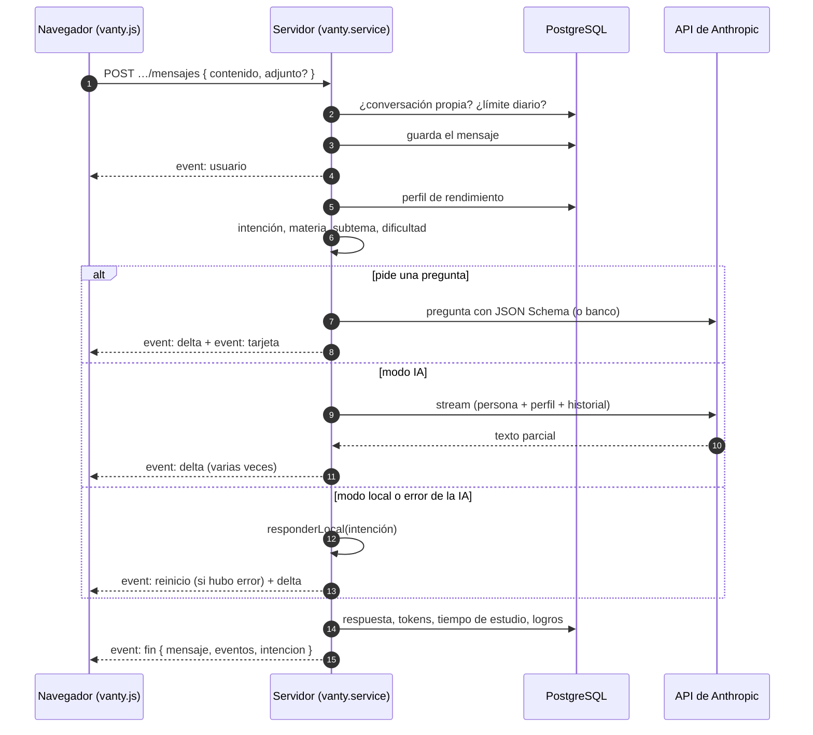

# Vanty, la IA tutora

Vanty es la tutora de ICFES Lab. Resuelve dudas de las 5 áreas, explica preguntas (incluido por qué la opción elegida es incorrecta), recomienda qué estudiar, adapta la dificultad, genera preguntas personalizadas y motiva al estudiante. Para hacerlo analiza su rendimiento: precisión por área y por tema, errores frecuentes, temas débiles, tiempos de respuesta, racha, simulacros y puntaje estimado.

Código: [`backend/src/services/vanty/`](../backend/src/services/vanty) · Interfaz: [`frontend/vanty.html`](../frontend/vanty.html) y [`frontend/js/paginas/vanty.js`](../frontend/js/paginas/vanty.js).

## Dos modos

| | **Modo IA (Claude)** | **Modo local** |
|---|---|---|
| Cuándo | Hay `ANTHROPIC_API_KEY` en el `.env` | Sin clave, con `VANTY_PROVEEDOR=local` o cuando la API falla |
| Respuestas | Generadas por Claude en streaming, con el perfil de rendimiento del estudiante y el historial de la conversación | Reglas por intención + base de conocimiento (40 entradas) + lecciones + datos reales del estudiante |
| Preguntas personalizadas | Nuevas, creadas para el estudiante (salida estructurada con JSON Schema) | Elegidas del banco con la práctica adaptativa |
| Costo | Según el uso de la API de Anthropic | Gratis |

`VANTY_PROVEEDOR` acepta `auto` (por defecto: Claude si hay clave), `claude` o `local`. La interfaz muestra el modo activo ("IA avanzada" o "Modo local").

**Respaldo automático.** Si Claude falla (clave inválida, sin conexión, límite de la API, error del servidor), el mensaje se responde en modo local con una nota breve ("La clave de la API de IA no es válida. Te respondo en modo local.") y el detalle técnico queda en el registro del servidor. Si falla la generación de una pregunta, se usa una del banco. El estudiante nunca se queda sin respuesta.

---

## Flujo de un mensaje

El navegador lee el stream con `fetch` + `ReadableStream` y renderiza el texto con un markdown ligero y seguro (negritas, cursivas, listas, código, tablas y solo enlaces internos). Si el estudiante cierra la página, el servidor cancela la petición a la API.

## Interfaz

- **Conversaciones:** lista lateral (panel deslizable en móvil), nueva conversación y eliminación. El título se toma del primer mensaje.
- **Sugerencias rápidas:** "¿Qué debo estudiar hoy?", "Genera una pregunta de mi tema más débil", "Explícame mi último error", "¿Cómo voy?", "Dame estrategias para el ICFES", "Motívame".
- **Tarjetas de pregunta:** se responden dentro del chat (cuentan como práctica: dan XP y actualizan el dominio). Después se puede pedir "¿Por qué fallé?", "Explícame más" u "Otra similar".
- **Panel de análisis** (pantallas anchas): recomendaciones automáticas, temas débiles y fuertes y tiempo por pregunta.
- **Accesos desde otras páginas:** "Pregúntale a Vanty" (al fallar en la práctica y en la revisión de simulacros) y "Repasar" (en los errores frecuentes de Avance) abren el chat con la pregunta adjunta y piden la explicación paso a paso; "Hablar con Vanty" en una lección abre el chat con el tema.
- **Uso diario:** contador de mensajes frente al límite diario.

---

## Perfil de rendimiento

`contexto.js` construye, en cada mensaje, un perfil con datos reales del estudiante. En modo IA se envía a Claude como un bloque de **datos** del prompt del sistema (nunca como instrucciones):

| Dato | Detalle |
|---|---|
| Identidad | Nombre para mostrar (o primer nombre), grado, nivel, XP, XP que faltan para el siguiente nivel y qué desbloquea. |
| Constancia | Racha actual y récord, si ya estudió hoy, minutos de hoy frente a la meta diaria, días activos en la última semana. |
| Examen | Días que faltan para el Saber 11 (fecha personal o global). |
| Rendimiento por área (90 días) | Precisión, número de preguntas, tiempo promedio frente al esperado, puntaje estimado. Áreas sin práctica. |
| Temas | Débiles (precisión < 60 % con 2+ respuestas) y fuertes (≥ 70 % con 3+ respuestas). |
| Errores frecuentes | Las 5 preguntas más falladas en 60 días (enunciado resumido, área, subtema y veces). |
| Simulacros | Los 3 últimos con puntaje y porcentaje. |
| Puntaje | Global estimado, confianza, proyección al examen y meta del estudiante. |

## Intenciones

`intenciones.js` clasifica cada mensaje con expresiones regulares sobre el texto normalizado (sin tildes, en minúsculas). También extrae la **materia**, el **subtema** y la **dificultad** ("fácil", "media", "difícil") cuando se mencionan.

| Intención | Ejemplos | Qué hace |
|---|---|---|
| `generar_pregunta` | "genera una pregunta de geometría", "dame un ejercicio difícil", "otra similar" | Tarjeta interactiva personalizada. |
| `explicar_pregunta` | "¿por qué fallé la última pregunta?", mensaje con una pregunta adjunta | Explica la respuesta correcta, por qué falla la opción elegida y un tip ICFES. |
| `recomendacion` | "¿qué debo estudiar?", "¿por dónde empiezo?", "plan de estudio" | Recomendaciones personalizadas. |
| `rendimiento` | "¿cómo voy?", "mi puntaje estimado", "mis debilidades" | Resumen de precisión, mejor área, área a reforzar, temas débiles, puntaje y racha. |
| `estrategia` | "consejos para el examen", "¿cómo manejo el tiempo?" | Estrategias de examen. |
| `motivacion` | "estoy cansado", "me siento estresado", "motívame" | Mensaje de ánimo personalizado. |
| `ayuda` | "¿qué puedes hacer?" | Presentación de sus funciones. |
| `saludo` / `agradecimiento` | "hola", "gracias" (mensajes cortos) | Respuesta breve con la racha o los días al ICFES. |
| `duda_academica` | cualquier otra cosa | Explicación del tema (Claude) o búsqueda en la base de conocimiento y en las lecciones (modo local). |

En modo IA, la intención decide si se genera una tarjeta y cómo se clasifica el mensaje (`texto`, `explicacion`, `recomendacion`); el resto lo responde Claude libremente dentro de su rol.

Solo las intenciones académicas (`duda_academica`, `explicar_pregunta`, `generar_pregunta`, `estrategia`) suman 30 s de estudio al día y mantienen la racha.

## Recomendaciones automáticas

`recomendaciones.js` produce hasta 6 recomendaciones ordenadas por prioridad. Se muestran en el dashboard (3), en Avance, en el panel de Vanty y en sus respuestas de modo local.

| Prioridad | Regla | Recomendación |
|---|---|---|
| 100 / 90 | Menos de 5 respuestas | Empezar con la lección del día y hacer el Minisimulacro 1 como diagnóstico. |
| 95 | Racha ≥ 2 días y aún no estudia hoy | Proteger la racha con 10 minutos de práctica. |
| 85 / 80 | Temas débiles (máx. 2) | Practicar el subtema con su precisión y número de respuestas. |
| 80 | Faltan 30 días o menos para el examen | Priorizar simulacros completos y repasar errores. |
| 75 | Un área sin practicar | Dedicarle una sesión corta. |
| 70 | 30+ respuestas y ningún simulacro en 10 días | Presentar un simulacro. |
| 65 | Tiempo por pregunta > 140 % del esperado, o < 35 % con precisión < 55 % | Entrenar el ritmo (reto Relámpago) o leer con más calma. |
| 60 | Faltan ≤ 120 XP para subir de nivel | Lo que desbloqueará el siguiente nivel. |
| 55 | La proyección está por debajo de la meta de puntaje | Cómo cerrar la brecha. |
| 40 | Tiene un tema fuerte | Mantener el nivel con retos más difíciles. |

## Preguntas personalizadas

1. **Tema:** en orden, una pregunta similar a la adjunta o a la última tarjeta ("otra similar"), el subtema pedido, la materia pedida (su subtema con menor dominio), el tema más débil del estudiante o, si no hay datos, un subtema desbloqueado con bajo dominio.
2. **Dificultad:** la pedida o la que corresponde al dominio del estudiante (baja < 40 · media < 70 · alta ≥ 70).
3. **Modo IA:** Claude recibe el área, el subtema, la dificultad, las competencias ICFES del área y hasta 3 preguntas que el estudiante falló en ese subtema (como inspiración, sin repetirlas). Responde con **salida estructurada** (`output_config.format` con JSON Schema): contexto, enunciado, 4 opciones con retroalimentación, explicación y competencia. El servidor valida que haya exactamente 4 opciones y 1 correcta, baraja las opciones y guarda la pregunta como **privada** del estudiante (`origen = 'vanty'`).
4. **Modo local o error:** se elige del banco con la práctica adaptativa.

Las respuestas a estas tarjetas pasan por `/api/practica/responder` con `origen = 'vanty'`: otorgan XP, actualizan el dominio y quedan en la analítica.

---

## Parámetros del modelo

| Parámetro | Valor | Variable |
|---|---|---|
| Modelo | `claude-opus-5` | `VANTY_MODEL` |
| Esfuerzo | `medium` (configurable en el chat; fijo en `medium` al generar preguntas) | `VANTY_EFFORT` |
| Tokens máximos de salida | 16 000 (el prompt pide respuestas de menos de 220 palabras) | — |
| Historial enviado | Últimos 20 mensajes de la conversación | — |
| Streaming | Sí (`client.beta.messages.stream`) | — |
| Caché de prompts | El prompt de personalidad es fijo y lleva `cache_control`; la API lo reutiliza entre mensajes cuando el prefijo alcanza el tamaño mínimo de caché del modelo | — |
| Respaldo del servidor | `fallbacks: "default"` con la beta `server-side-fallback-2026-07-01`: si el modelo declina una solicitud, la API la reintenta con el modelo de respaldo recomendado. Si la cuenta no admite la función, se desactiva sola | `VANTY_FALLBACKS` |
| Reintentos y tiempo máximo | 2 reintentos automáticos del SDK, 120 s | — |

Si la respuesta termina por `refusal`, Vanty agrega una frase que reconduce la conversación al ICFES; si termina por `max_tokens`, se marca con "…".

**Prompts** ([`prompts.js`](../backend/src/services/vanty/prompts.js)):

- `PERSONA_VANTY`: tono (español de Colombia, cercano, pedagógico y conciso), formato (párrafos cortos, listas, negritas, símbolos Unicode en lugar de LaTeX), funciones, secciones de la plataforma que puede recomendar y límites: solo temas académicos y de bienestar para estudiar, no inventar datos del estudiante ni datos oficiales del ICFES (remite a www.icfes.gov.co), y ante angustia seria o menciones de hacerse daño responder con empatía y animar a buscar de inmediato a un adulto de confianza, al orientador del colegio o a los servicios de emergencia.
- `PROMPT_GENERADOR` y `ESQUEMA_PREGUNTA`: reglas de diseño de ítems tipo ICFES (contexto, 4 opciones plausibles con errores típicos, retroalimentación por opción, explicación paso a paso; en Inglés el ítem va en inglés y la explicación en español).

## Límites y costos

| Límite | Valor |
|---|---|
| Mensajes por minuto por estudiante | 12 (incluye la generación de preguntas) |
| Mensajes diarios por estudiante | 80 (configurable por el administrador entre 1 y 1000) |
| Longitud de un mensaje | 2000 caracteres |

Cada respuesta guarda `tokens_entrada`, `tokens_salida` y el `proveedor` en `mensajes_vanty`, así que el consumo se puede medir con SQL (ver [Consultas útiles](BASE_DE_DATOS.md#consultas-útiles)) y multiplicar por los precios vigentes de Anthropic. Para reducir el costo: bajar `VANTY_EFFORT` a `low`, usar un modelo más económico (por ejemplo `VANTY_MODEL=claude-sonnet-5`) o reducir el límite diario desde el panel de administración.

## Activar Claude

1. Crea una clave en [console.anthropic.com](https://console.anthropic.com).
2. Agrégala al `.env`: `ANTHROPIC_API_KEY=sk-ant-...`
3. Reinicia el servidor. La consola mostrará `Vanty: Claude (claude-opus-5)` y el chat, el distintivo "IA avanzada". También puedes comprobarlo con `GET /api/vanty/estado`.

Si la clave no es válida, el chat sigue funcionando en modo local y cada respuesta lo indica.

## Modo local

- **Base de conocimiento:** `database/contenido/conocimiento/*.json`, 8 entradas por área con título, explicación, ejemplo, tip ICFES y palabras clave. Se buscan por coincidencia de palabras clave y título (sin tildes).
- **Lecciones:** busca las lecciones cuyo título, resumen o subtema coinciden con la pregunta y las enlaza.
- **Explicaciones:** usa la retroalimentación de la opción elegida, la explicación oficial de la pregunta y el tip ICFES del subtema.
- **Recomendaciones, rendimiento, estrategias y motivación:** a partir del perfil de rendimiento.
- El texto se envía en fragmentos cortos para mantener el efecto de escritura.

Para ampliar la base de conocimiento agrega entradas a los JSON (el formato está en [FORMATO.md](../database/contenido/FORMATO.md)) y reinicia el servidor.

---

## Privacidad y seguridad

- **Qué se envía a Anthropic (solo en modo IA):** el nombre para mostrar o primer nombre, el grado, las estadísticas de estudio del perfil, los enunciados resumidos de sus errores frecuentes, los últimos 20 mensajes de la conversación y la pregunta adjunta. **No** se envían el correo, la contraseña, el colegio ni la ciudad.
- **Dónde se guarda:** las conversaciones viven en la base de datos de la plataforma (`conversaciones_vanty`, `mensajes_vanty`). El estudiante puede borrar cada conversación y, al eliminar su cuenta, se borran todas.
- **Menores de edad:** la mayoría de usuarios del Saber 11 son menores. Antes de activar la IA en un colegio, revisa las políticas de uso de datos de la API de Anthropic, informa a los acudientes y cumple la Ley 1581 de 2012 de protección de datos personales. Con `VANTY_PROVEEDOR=local` ningún dato sale del servidor.
- **Inyección de instrucciones:** el perfil y las preguntas adjuntas se marcan como datos de la plataforma, y el prompt del sistema indica no seguir órdenes que aparezcan en ellos. Las preguntas generadas se validan antes de guardarse y siempre quedan privadas.
- **Contenido:** el markdown de las respuestas se renderiza sin HTML y solo con enlaces internos, así que una respuesta no puede inyectar código ni sacar al estudiante de la plataforma.

## Personalizar a Vanty

| Qué | Dónde |
|---|---|
| Personalidad, tono y límites | `PERSONA_VANTY` en `prompts.js` |
| Reglas para generar preguntas | `PROMPT_GENERADOR` y `ESQUEMA_PREGUNTA` en `prompts.js` |
| Competencias por área | `COMPETENCIAS` en `vanty.service.js` |
| Palabras que activan cada intención | `intenciones.js` |
| Reglas y prioridades de las recomendaciones | `recomendaciones.js` |
| Frases motivacionales y estrategias | `motivacion.js` y `local.js` |
| Base de conocimiento | `database/contenido/conocimiento/*.json` |
